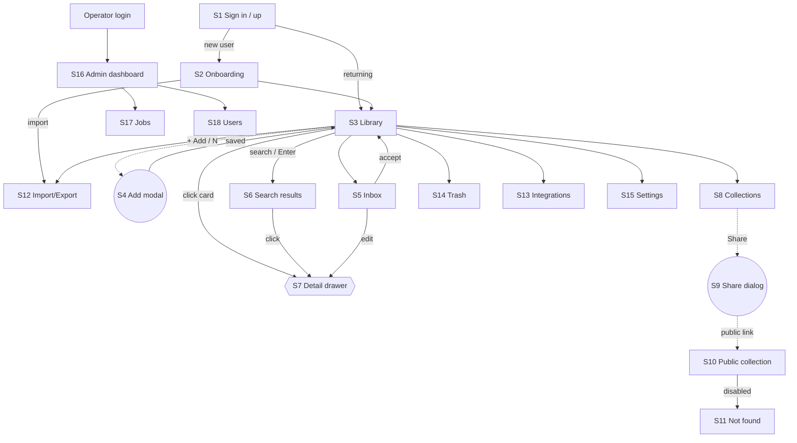

> Superseded 2026-10-23: `.ai/specs/product-brief.md` is the product source of truth (D39). Kept as history.

# 3. Screen and navigation map

## Screen inventory

| ID | Screen | Area | Presentation | Route (proposed) | Mockup hash |
|---|---|---|---|---|---|
| S1 | Sign in / Sign up | public | full page | `/login`, `/signup` | `#/login` |
| S2 | Onboarding | app | full page | `/welcome` | `#/welcome` |
| S3 | Library | app | main layout | `/library`, `/library/c/:id`, `/library/t/:tag` | `#/library` |
| S4 | Add bookmark | app | modal over any screen | – | modal |
| S5 | Inbox (AI review) | app | main layout | `/inbox` | `#/inbox` |
| S6 | Search results | app | main layout | `/search?q=` | `#/search` |
| S7 | Bookmark detail | app | right drawer | `/b/:id` | drawer |
| S8 | Collections | app | main layout | `/collections` | `#/collections` |
| S9 | Share dialog | app | modal | – | modal |
| S10 | Public collection | public | full page | `/s/:slug` | `#/public` |
| S11 | Not found / disabled link | public | full page | any | `#/notfound` |
| S12 | Import / Export | app | main layout | `/data` | `#/data` |
| S13 | Integrations | app | main layout | `/integrations` | `#/integrations` |
| S14 | Trash | app | main layout | `/trash` | `#/trash` |
| S15 | Settings (profile, AI) | app | main layout | `/settings` | `#/settings` |
| S16 | Admin dashboard | admin | admin layout | `/admin` | `#/admin` |
| S17 | Admin jobs | admin | admin layout | `/admin/jobs` | `#/admin/jobs` |
| S18 | Admin users | admin | admin layout | `/admin/users` | `#/admin/users` |

Mapping to the project's styling rule: S1, S10, S11 are public pages (plain Tailwind, `(site)` layout). S2–S9, S12–S15 are the product app and S16–S18 the admin area; the stack currently names only "public" and "admin" groups, so the product app needs a decision: see *Open questions*.

## Navigation map



Legend: rectangle = page, double-circle = modal, hexagon = drawer.

## Global layout (S2–S9, S12–S15)

```
┌────────────┬──────────────────────────────────────────┬───────────┐
│ Sidebar    │ Top bar: [Search /]        [+ Add]  [☺]  │ Drawer    │
│  All       ├──────────────────────────────────────────┤ (S7 when  │
│  Inbox (n) │ Page header + view toggle + filters      │  open)    │
│  Favourites│                                          │           │
│  Collections│ Content                                 │           │
│  Types     │                                          │           │
│  Tags      │                                          │           │
│  ─────     │                                          │           │
│  Trash     │                                          │           │
│  Settings  │                                          │           │
└────────────┴──────────────────────────────────────────┴───────────┘
```

- Sidebar collapses to a bottom tab bar on mobile (Library, Inbox, Search, Add, More).
- Drawer becomes a full-screen sheet on mobile.

## Keyboard shortcuts

| Key | Action |
|---|---|
| `N` | Add bookmark |
| `/` | Focus search |
| `G` then `I` | Go to Inbox |
| `Esc` | Close modal / drawer |
| `E` (drawer open) | Edit title |

## Open questions

1. **Styling group for the product app.** AGENTS.md defines `(site)` (Tailwind) and `(admin)` (shadcn). The Collector's app is neither. Recommendation: build it in shadcn/ui under its own route group `(app)` so it shares components with admin and keeps `(site)` for S1, S10, S11 only. Needs approval before implementation.
2. **Auth provider.** Not decided here; mockup assumes email + password and magic link.
3. **Semantic search.** Needs pgvector on PostgreSQL 17; deferred to phase 2.
