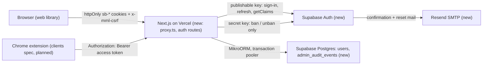
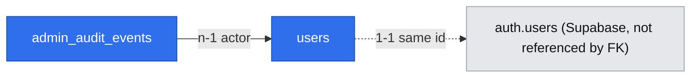

# Platform foundation: Supabase auth, users and admin, stack and standards update

- Status: approved (2026-10-23, Paweł Wójcik)
- Date: 2026-10-23
- Owner: Paweł Wójcik
- Source: `.ai/specs/product-brief.md` (D46–D51, D53–D61)

## 📝 TLDR

Every MVP feature spec (extraction, clients, library) needs a signed-in user and an owner id to scope rows by. It also needs project docs that describe the real stack. Today the repo has no auth and no users, and `AGENTS.md` plus `engineering-standards.md` still describe the superseded concept. This spec proposes four things:

- Supabase sign-in (email + password with confirmation, Google), run through the Next.js server with httpOnly cookies.
- Bearer verification for the Chrome extension.
- Our own `users` table, with admin accounts and suspension.
- An append-only admin audit table.

It also moves local dev and integration tests to the Supabase CLI stack and rewrites the docs to match D46–D61.

## 📝 Problem Statement

- No identity exists. `SessionReader` (`packages/core/src/http/auth.ts`) is a port with no implementation, so nothing can be owner-scoped and R20 (private libraries) cannot be enforced.
- `/admin` is public today. `packages/app/src/app/(admin)/admin/page.tsx` renders the database status to anyone.
- The docs agents follow are wrong for this product:
  - `AGENTS.md` lists the concepts `collections`, `tags` and `transfer`, which N12 removed.
  - The standards describe in-house password hashing, `after()` jobs and an open auth decision; D22, D46 and D48 settled all three.
  - `.ai/lessons.md` (2026-10-23) already flags that agents have to override the docs with the brief by hand.
- D42, D47 and D51 need a users table, a server-checked `isAdmin` flag and an audit trail before any admin screen can exist.
- There is no production: no Supabase project, no Vercel project, nothing at mml-bookmarks.hunger-programmers.com (D61).

## 📝 Resolved scope (gate answers, 2026-10-23, Paweł Wójcik)

All six gate questions were answered with the recommended option:

| Q | Answer | Effect |
|---|---|---|
| Q1 | The worker runtime, job table, retries and Fly.io deploy (D48, D56) move to the extraction spec | Narrows D53's scope list for this spec |
| Q2 | Here: user list, suspend/unsuspend, audit table and its view. Impersonation goes to the library spec; failed jobs go with the worker | Narrows D53 |
| Q3 | Personal tokens (R23, D60) go to the clients spec with the iOS Shortcut. This spec keeps the `requireToken` port unchanged | Narrows D53 |
| Q4 | The Supabase CLI local stack for dev, integration tests and CI. `docker-compose.yml` and `@testcontainers/postgresql` are removed | Changes the AGENTS.md stack table (approved) |
| Q5 | Email confirmation on sign-up, custom SMTP through Resend | New external service (approved) |
| Q6 | A new `(app)` route group on shadcn and the `ui` theme | Closes standards open decision #1 |

## 📝 Proposed Solution

### Docs and stack

Phase 1 changes the decision-level text: concepts, stack choices, standards. Rules and commands that depend on tooling not yet in the repo are written by the phase that adds the tooling, so agents never get instructions for something that does not exist yet:

- `supabase:start`, the removal of docker compose and the integration-test row: Phase 2.
- The RLS and migration-connection rules: Phase 3.
- The deploy pipeline: Phase 6.

`AGENTS.md`:

- **Stack table** — change these rows:
  - Database: Supabase Postgres 17.
  - Auth: Supabase Auth through `@supabase/ssr` + `@supabase/supabase-js`.
  - Validation: Zod 4.
  - Integration tests: Supabase CLI local stack + agent-browser.
  - Hosting: Vercel (web); the Fly.io worker is added by the extraction spec.
  - Email: Resend SMTP behind Supabase Auth.
- **Monorepo layout**: add a `packages/extension` row and the rule `extension → core` (D49). The package itself is created by the clients spec.
- **Concept list**: `auth`, `admin`, `bookmarks`, `recipes`, `extraction`, `search`. `admin` becomes a concept because it now owns data (the audit table); the standards' "admin is not a concept" line goes.
- **Styling**: add the `(app)` route group (shadcn, `ui` theme).
- **Database**: remove `docker compose up -d`; add `pnpm supabase:start` and these rules:
  - Every table gets RLS enabled.
  - No foreign key into the `auth` schema.
  - Migrations run over the session/direct connection, the app over the transaction pooler.
- **Commands**: update the table to match.

`engineering-standards.md`:

- Replace the concept table.
- Replace the auth bullet under Security with the Supabase rules below.
- Replace the async-enrichment paragraph with a pointer to the extraction spec (D48).
- Close open decisions #1–#3.
- Drop the collections, tags, public-share and import rules (N12).
- Keep the capture-token rule; R23 restates it.

Other docs:

- Add a superseded banner to `.ai/mockups/funtionality/docs/` (D39).
- Remove the 2026-10-23 lesson about docs disagreeing with the brief once this lands.

### Authentication (D46)

The browser only ever talks to our origin. The Supabase secret key is used in exactly one adapter.

- **Web session.** `@supabase/ssr` `createServerClient` runs only on the server, with `cookieOptions` `{ httpOnly: true, secure: production, sameSite: "lax", path: "/" }`.
  - httpOnly is safe here because no browser-side Supabase client exists. The library defaults to `httpOnly: false` only because browser clients need the refresh token (verified in the `supabase/ssr` source and its advanced guide).
  - Sign-in, sign-up, Google OAuth start and callback, email confirmation, password reset and sign-out are all route handlers.
- **Refresh.** `packages/app/src/proxy.ts` (Next.js 16 renamed middleware to proxy) calls `supabase.auth.getClaims()` on every page and `/api` request that carries `sb-` cookies. That refreshes an expired access token, which Supabase's Next.js 16 guide prescribes.
  - The rotated cookies are written twice: onto the forwarded request (`NextResponse.next({ request })` after `request.cookies.set`), so the route handler or page in the same request sees the fresh token, and onto the response, so the browser stores them. Writing only the response would make the first request after expiry answer `401`.
  - The proxy only refreshes. It does not authorise anything; authorisation stays in `requireSession` (Next.js docs: Proxy "should not be used as a full session management or authorization solution").
- **CSRF on unauthenticated writes.** Sign-up, sign-in, password reset and confirm have no session, so `requireSession` never runs on them. A new `requireCsrf(request)` in `core/http` is called by those routes. `requireSession` uses the same helper for cookie sessions. This closes login CSRF.
- **Password change needs a fresh recovery.** `POST /api/v1/auth/password` accepts only a session whose `amr` claim holds a `recovery` or `otp` entry less than 10 minutes old. Any other session gets `403 reauthentication_required`. Otherwise a stolen session cookie could set a new password. `secure_password_change = true` is also set in Supabase as a second check. The exact `amr` method name Supabase issues after `verifyOtp({ type: "recovery" })` is checked in the Phase 4 integration test, not assumed.
- **Bearer.** `Authorization: Bearer <access token>` is verified with `supabase.auth.getClaims(jwt)`.
  - Projects on asymmetric signing keys (ES256) verify locally against the JWKS. The local CLI stack issues ES256 user tokens by default (verified in the CLI source).
  - A legacy HS256 project would make each verification a network call to Supabase Auth. The production project is created with asymmetric keys.
- **One reader.** `SupabaseSessionReader` in `packages/app/src/server/auth/` implements `SessionReader.getSession`:
  1. A Bearer header wins over cookies. A request carrying both is treated as Bearer and its cookies are ignored.
  2. The verified `sub` is looked up in `users` (upserted on first sight, see Data Model).
  3. It returns `{ userId, isAdmin, suspended, via: "cookie" | "bearer" }`.
  - `getToken` stays unimplemented (returns `null`) until the clients spec adds personal tokens.
- **Core changes** (`packages/core/src/http/auth.ts`):
  - `Session` gains `via` and `suspended`.
  - `requireSession` checks CSRF only when `via === "cookie"`, which is the existing standard: Bearer clients send no ambient credential.
  - It throws `AccountSuspendedError` (403, `account_suspended`) for a suspended user.
  - Fail-closed handling stays as it is.
  - The suspension check lives in a shared `assertActive(principal)` helper. The clients spec must call it from `requireToken` as well, so a suspended user's personal tokens stop working. This is recorded there as a requirement.
- **Accepted:** sign-out clears cookies and revokes the refresh token, but an already-issued Bearer access token stays valid until `exp` (Supabase default: 1 hour). Suspension does not have this gap, because our flag is checked on every request.
- **Suspension is checked by us on every request**, not left to Supabase. A Supabase ban blocks sign-in and refresh, but an access token verified locally stays valid until `exp` (verified in the `supabase/auth` admin source). Our `suspended_at` flag closes that gap at once (D47).

**Alternatives rejected:**

- A browser Supabase client with JS-readable cookies: breaks the httpOnly standard (D46).
- Our own encrypted session cookie wrapping the Supabase refresh token: re-implements what `@supabase/ssr` already does.
- `getUser()` on every request: a network round trip per request; `getClaims()` verifies locally.
- API keys exchanged for a password, as Karakeep and Linkwarden do for their extensions: D46 chose Supabase Bearer tokens for the extension, and personal tokens exist only for the Shortcut (R23).

### Users and admin (D42 subset, D47, D51)

- **Provisioning.** The first authenticated request for a Supabase user inserts a `users` row (`insert … on conflict (id) do nothing`, then read). The email is copied from the verified claims and refreshed when it changes. No Supabase webhook or database trigger into `auth` is involved.
- **First admin.** `pnpm admin:grant <email>` / `pnpm admin:revoke <email>`: a `packages/db` script that flips `is_admin` on an existing `users` row (the person must have signed in once). There is no UI to grant admin, because that would be one more privilege-escalation surface.
- **Suspend** (`AdminService.suspendUser(actor, subjectId)`):
  1. In one transaction: set `suspended_at` and insert the `user.suspended` audit event. Skip both if the user is already suspended.
  2. Then call `AuthAdmin.banUser(subjectId)` (Supabase `ban_duration: "876000h"`; there is no "forever" value).
  3. If the ban fails, the flag still blocks every API call (fail closed). The route answers `502 auth_provider_error` and the admin can retry. A retry re-bans without a second audit row.
- **Unsuspend**, in the reverse order:
  1. `AuthAdmin.unbanUser` (`ban_duration: "none"`).
  2. Then clear the flag and write `user.unsuspended`.
  3. If the unban fails, the user stays fully suspended.

  Neither order can leave a user who has access we meant to remove.
- **Guards:**
  - Admin accounts cannot be suspended (`409 cannot_suspend_admin`); revoke admin first. This prevents an admin lockout.
  - An admin cannot suspend themselves.
- **`AuthAdmin` port** in `core/src/services/admin/`, with its Supabase adapter in `app/src/server/auth/` (the standards keep vendor SDKs out of `core` and `db`). It is the only code that holds `SUPABASE_SECRET_KEY`.
- **Audit (R20, D51).** Every admin mutation writes one event in the same transaction as the change. The table has no update or delete path in code, and a trigger rejects `UPDATE` and `DELETE` at the database level. Impersonation events are added by the library spec using the same table.

### Email (Q5)

- Supabase Auth sends confirmation and password-reset mail over custom SMTP: `smtp.resend.com:465`, user `resend`, password = a Resend API key, sender `no-reply@hunger-programmers.com` (domain verified in Resend).
- Resend's free tier (3,000/month, 100/day) covers the pilot.
- Supabase's own limit after custom SMTP starts at 30 mails/hour. Raising it is a dashboard setting.
- Locally, Mailpit (port 54324) captures every mail, and integration tests read confirmation links from its API. `enable_confirmations = true` is set in `supabase/config.toml` so local behaviour matches production.

### Local stack and tests (Q4, D50)

- `supabase/config.toml` is committed: `[db] major_version = 17`, `[auth] site_url`, redirect allow-list, `enable_confirmations = true`, `secure_password_change = true`, `minimum_password_length = 8` (matches the Zod schema), and `[auth.external.google]` with env-substituted client id and secret. The production project gets the same auth settings in Phase 6.
- The `supabase` CLI is a root dev dependency, so its version is pinned, and it is listed in `allowBuilds` (lesson 2026-10-14).
- `pnpm supabase:start` runs `supabase start -x realtime,storage-api,imgproxy,edge-runtime,logflare,vector,studio`. The excluded services are unused.
- `.env.example` documents that the values come from `supabase status -o env` (`API_URL`, `DB_URL`, `PUBLISHABLE_KEY`, `SECRET_KEY`).
- Integration global setup:
  1. Starts the stack if `supabase status` fails.
  2. Runs `supabase db reset`, which wipes the `public` and `auth` data.
  3. Applies MikroORM migrations, then starts `next start` against it.
- Tests create confirmed users through the admin API, or sign up and follow the Mailpit link.
- **CI:** the integration job adds `supabase/setup-cli@v3` and `pnpm supabase:start`. The build job keeps running with no `DATABASE_URL` and no Supabase variables.

### Production (D55, D58, D61)

- **Supabase:** one project, EU region, asymmetric JWT signing keys, Google provider, custom SMTP, Site URL `https://mml-bookmarks.hunger-programmers.com`, redirect allow-list = that origin + `http://localhost:3000`.
- **Vercel:** one project for `packages/app`, custom domain `mml-bookmarks.hunger-programmers.com` (CNAME at the DNS host of hunger-programmers.com).
- **Connections:**
  - `DATABASE_URL` = transaction pooler (port 6543) with `DB_POOL_MAX=1` per serverless instance.
  - `MIGRATION_DATABASE_URL` = session pooler (port 5432).
  - node-postgres only prepares named statements when given a `name`, so the transaction pooler should be safe. That is an inference, not documented by MikroORM; Phase 6 verifies it with a smoke test.
- **Deploy pipeline:** `.github/workflows/deploy.yml` runs on push to `main` in this order:
  1. `migrate`: `pnpm db:migration:up` with `MIGRATION_DATABASE_URL`.
  2. `deploy`: `vercel deploy --prebuilt --prod`, only if `migrate` succeeded.
  - Vercel's Git auto-deploy for production is turned off, so a failed migration never ships code against the old schema.
  - Preview deployments are disabled. D58 says there is no staging, and a preview with production env vars would run PR code against the production database.
  - Migrations stay additive and backward-compatible with the previous release, because for a few seconds the old deployment serves traffic against the new schema. Destructive changes ship in a later release.
  - `MIGRATION_DATABASE_URL` and `VERCEL_TOKEN` live in GitHub secrets.
  - Rejected: Git auto-deploy plus a parallel `migrate` job. A failed migration would leave new code live against the old schema.
  - Rejected: Vercel Deployment Checks gating promotion on the `migrate` check. It works, but splits the ordering across two systems.
  - Rejected: migrating inside the Vercel build. That puts DB credentials in the build, and the build job must pass without a database.
  - Rejected: manual migration. It gets forgotten.
- **Google OAuth:** a Google Cloud OAuth client with the Supabase callback URLs (production project and `http://127.0.0.1:54321/auth/v1/callback`).

## 📝 Architecture

| Area | New / changed | Where |
|---|---|---|
| Session port | changed: `Session.via`, `Session.suspended`, CSRF only for cookie, `AccountSuspendedError` | `core/src/http/auth.ts`, `errors.ts` |
| Validation | new: Zod schemas, shared by route and form | `core/src/validators/auth/*.schema.ts` |
| Users | new: `User` entity, `UserRepository` port + implementation, `UserService` (`resolve(claims)`) | `db/src/entities/auth/`, `db/src/repositories/auth/`, `core/src/services/auth/` |
| Admin | new: `AdminAuditEvent` entity, repository, `AdminService`, `AuthAdmin` port | `db/.../admin/`, `core/src/services/admin/` |
| Supabase adapters | new: server client factory, `SupabaseSessionReader`, `SupabaseAuthAdmin`, env schema | `app/src/server/auth/`, `app/src/server/env.ts` |
| Proxy | new: session refresh only | `app/src/proxy.ts` |
| Composition root | registers the reader, adapters, services | `app/src/server/container.ts` |
| Routes | new: `/api/v1/auth/*`, `/api/v1/me`, `/api/v1/admin/*`; browser redirect handlers `/auth/callback`, `/auth/confirm` | `app/src/app/` |
| Pages | new `(app)` group: sign-in, sign-up, forgot / reset password, `/library` placeholder; `(admin)` guarded, plus users and audit pages | `app/src/app/(app)/`, `(admin)/admin/` |
| Tooling | new: `supabase/config.toml`, `pnpm supabase:start`, `admin:grant/revoke`; removed: `docker-compose.yml`, Testcontainers | root, `packages/db`, `packages/integration` |

Current consumers: none; nothing is authenticated today. Planned consumers: the extraction, clients and library specs scope every row by `users.id` and call `requireSession`.

**Env vars** (validated with Zod on first use, not at import, so `next build` passes with none set):

| Var | Value |
|---|---|
| `SUPABASE_URL` | Supabase project URL |
| `SUPABASE_PUBLISHABLE_KEY` | `sb_publishable_…` |
| `SUPABASE_SECRET_KEY` | server only |
| `SITE_URL` | origin for redirect URLs |
| `MIGRATION_DATABASE_URL` | CI only |

None is `NEXT_PUBLIC_`. The logger redacts `authorization`, `cookie` and `sb-*`.

## 📝 Data Model

**`users`** (concept `auth`):

| Column | Type | Notes |
|---|---|---|
| `id` | uuid PK | = Supabase `auth.users.id` (the JWT `sub`); not generated by us |
| `email` | text not null | copied from claims; PII, shown only in the admin list |
| `is_admin` | boolean not null default false | set only by `admin:grant` |
| `suspended_at` | timestamptz null | non-null = suspended (D47's flag, with when) |
| `created_at` | timestamptz not null default now() | |

The daily counter in D47 is added by the extraction spec, its first reader (YAGNI).

There is no foreign key to `auth.users`. Supabase recommends `references auth.users on delete cascade`, and the cascade is the main thing an FK would buy. But the FK lives outside the entity metadata MikroORM diffs, so a later `migration:create` could propose dropping it, and the integration DB is reset with `supabase db reset` anyway. Account deletion (D37) deletes both sides in application code and lands with the library spec, when there is data to delete.

**`admin_audit_events`** (concept `admin`):

| Column | Type | Notes |
|---|---|---|
| `id` | uuid PK | |
| `actor_user_id` | uuid not null FK `users(id)` `on delete restrict` | the admin who acted |
| `actor_email` | text not null | snapshot, so the row reads correctly after changes |
| `subject_user_id` | uuid null | no FK: the event must outlive the subject's account deletion (D51 "kept indefinitely") |
| `subject_email` | text null | snapshot |
| `action` | text not null, check in (`user.suspended`, `user.unsuspended`) | the library spec extends the check for impersonation |
| `created_at` | timestamptz not null default now() | index `(created_at desc)` for the audit list |

- Append-only: migration-added triggers raise on `UPDATE` and `DELETE` (row level) and on `TRUNCATE` (statement level, since row triggers do not fire on it). Admin accounts are never deleted in the MVP, which keeps `on delete restrict` coherent.
- **Data API lockdown on every table.** Supabase exposes `public` through its Data API. The extension will ship the publishable key and hold user JWTs, so both `anon` and `authenticated` are exposed. Each migration that creates a table runs:
  - `alter table … enable row level security` with no policies;
  - `revoke all on … from anon, authenticated`.

  Our server connects as the database owner and bypasses both. Integration tests assert that `GET /rest/v1/users` returns no rows, or a permission error, with the publishable key alone and with a signed-in user's access token.

The dashed edge is an id convention, not a constraint. The subject reference is also deliberately unconstrained. With two entities, the interactive HTML view was skipped.

## 📝 API Contracts

All routes use `apiHandler`; bodies are parsed with Zod schemas from `core/src/validators/auth/`; errors follow `{ error: { code, message, fields? } }`.

| Method, path | Auth | Request | Success | Notable errors |
|---|---|---|---|---|
| `POST /api/v1/auth/sign-up` | none, `requireCsrf` | `{ email, password }` (password 8–72 chars) | `202 {}`, same body whether or not the email exists, and also on any provider error, including the email-send rate limit (logged) | `422 validation_failed` |
| `POST /api/v1/auth/sign-in` | none, `requireCsrf` | `{ email, password }` | `200 { id, email, isAdmin }` + session cookies | `401 invalid_credentials` (one message for wrong email or password); `403 email_not_confirmed`; `403 account_suspended`; `429 rate_limited`; `503 auth_unavailable` |
| `GET /api/v1/auth/google` | none | – | `302` to Supabase authorize (PKCE verifier in an httpOnly cookie) | – |
| `POST /api/v1/auth/sign-out` | session | – | `204`, cookies cleared | – |
| `POST /api/v1/auth/password-reset` | none, `requireCsrf` | `{ email }` | `202 {}` always, including on provider errors and rate limits (logged), so the response never reveals whether an account exists | `422` |
| `POST /api/v1/auth/confirm` | none, `requireCsrf` | `{ tokenHash, type: "signup" \| "recovery" }` | `200 { next: "/library" \| "/reset-password" }` + session cookies | `400 link_expired` |
| `POST /api/v1/auth/password` | session with a recovery `amr` entry under 10 minutes old | `{ password }` | `204` | `422`, `401`, `403 reauthentication_required` |
| `GET /api/v1/me` | session (cookie or Bearer) | – | `200 { id, email, isAdmin }` | `401`, `403 account_suspended` |
| `GET /api/v1/admin/users?cursor=` | admin | – | `200 { items: [{ id, email, isAdmin, suspendedAt, createdAt }], nextCursor }`, 50 per page, newest first | `403` |
| `POST /api/v1/admin/users/[id]/suspension` | admin, CSRF | – | `200` user | `404`, `409 cannot_suspend_admin`, `409 cannot_suspend_self`, `502 auth_provider_error` |
| `DELETE /api/v1/admin/users/[id]/suspension` | admin, CSRF | – | `200` user | `404`, `502 auth_provider_error` |
| `GET /api/v1/admin/audit?cursor=` | admin | – | `200 { items: [{ id, actorEmail, subjectEmail, action, createdAt }], nextCursor }` | `403` |
| `GET /auth/callback?code=` | none | – | `302` to `/library`, or `/sign-in?error=oauth` | – |
| `GET /auth/sign-out?reason=suspended` | none | – | clears cookies, `302` to `/sign-in?error=suspended` | – |

- Redirect targets are fixed paths, never taken from the query string (no open redirect).
- `/auth/*` are browser-navigation handlers, so they sit outside `/api/v1`.
- **Email links do not verify on GET.** The links in confirmation and reset mails open the `/auth/confirm` page. It shows a "Confirm" (or "Set a new password") button that calls `POST /api/v1/auth/confirm`. Mail scanners and link prefetchers issue GETs, which would otherwise spend the single-use `token_hash` before the user clicks.
- **Provider error mapping**, one function in `app/src/server/auth/`:
  - Supabase rate-limit errors → `429 rate_limited`.
  - Network or 5xx errors → `503 auth_unavailable`.
  - Banned user → `403 account_suspended`.
  - Anything else → `401 invalid_credentials` or the generic `202`, per the table.
  - The sign-up and password-reset routes override all of the above with the uniform `202`.
- Non-admins get `403` from the admin API. The admin pages answer `notFound()`, so the area's existence is not revealed.
- Rate limiting: Supabase Auth enforces its own per-IP limits. Our server is the caller, so every user shares the Vercel egress IPs. That is unverified and is a risk below, not a solved problem. No limiter of our own is added in this spec.

## 📝 UI/UX

- **`(app)` group:** a root layout importing `@mml-bookmark/ui/globals.css`, with shadcn `input`, `label`, `card` and `form` primitives added to `ui` through the CLI.
  - Forms post through `apiCall` and render field errors from `fields`.
  - The Google button is a plain link to `/api/v1/auth/google`.
  - Pages are phone-first (D54).
- **Pages:**
  - `/sign-in`, `/sign-up` ("Check your email to confirm" after submit), `/forgot-password`, `/reset-password`.
  - `/library`, a placeholder: `EmptyState` "Your library is empty", the signed-in email, sign out. The library spec replaces it; onboarding (D43) arrives with the clients spec, which has the extension to link to.
- **Session reads** happen in a component inside `<Suspense>` with the `LoadingState` fallback. `cookies()` outside a boundary is a build error with `cacheComponents`.
- **Redirects:**
  - A signed-out visitor to `(app)` pages goes to `/sign-in`.
  - A signed-in visitor to `/sign-in` goes to `/library`.
  - A suspended user is redirected to `/auth/sign-out?reason=suspended`, a route handler, because a Server Component cannot write cookies during render. It clears the cookies, and `/sign-in` shows "This account is suspended".
- **`(admin)`:** the layout requires an admin session (non-admin → `notFound()`).
  - `/admin`: the existing database status.
  - `/admin/users`: table with a Suspend / Unsuspend action and a confirm dialog.
  - `/admin/audit`: read-only list.
- **States:** every new screen reaches loading, empty, error and success through the `feedback/*` components.

## 📝 Edge Cases & Failure Scenarios

| Scenario | Behaviour |
|---|---|
| Sign-up with an email that already exists | Same `202` and "check your email"; Supabase sends no second account. No enumeration |
| Sign-in before confirming | `403 email_not_confirmed`, "Confirm your email first. Check your inbox." (only after a correct password, so no enumeration) |
| Confirmation or reset link expired or reused | `/sign-in?error=link_expired`, "This link has expired. Request a new one." |
| Google account with the same email as a password account | Supabase links identities by verified email; one `users` row (same `sub`) |
| Supabase Auth down | Sign-in, sign-up and refresh return `503 auth_unavailable`. A warm instance that has already cached the JWKS keeps verifying valid access tokens. A cold serverless instance cannot fetch the JWKS, so verification throws and fails closed: `401` for the API, sign-in redirect for pages. Accepted for the pilot; availability is Supabase's |
| Mail scanner opens a confirmation link | GET renders the interstitial only; the token is spent only by the user's click (POST) |
| A normal session calls `POST /api/v1/auth/password` | `403 reauthentication_required` |
| Access token expired, refresh fails | Proxy leaves the cookies; `requireSession` gets no session → `401` / redirect to sign-in |
| User suspended mid-session | Next request: `403 account_suspended`; pages sign them out. Their access token stays cryptographically valid until `exp`, and our flag makes that irrelevant |
| Ban call fails after the flag is set | User is blocked by our flag; admin sees "Suspended here, but Supabase didn't confirm the ban. Try again." |
| Two first requests from a new user at once | `on conflict do nothing` → one row |
| Bearer and cookie both present | Bearer wins, cookies ignored, no CSRF check |
| Publishable key used against the Data API | RLS with no policies → empty result |
| `next build` with no env | Builds; env is validated on first request, which fails with a clear "SUPABASE_URL is not set" in the server log and a generic 500 to the client |
| Many users signing in behind the shared Vercel IPs | May hit Supabase per-IP auth limits (unverified, see Risks). User sees `429 rate_limited` "Too many attempts. Try again in a minute." |

## 📝 Risks & Impact Review

- **Hard to reverse:**
  - `users.id` = Supabase id becomes the owner key of every future table, which ties all data to Supabase Auth. Leaving Supabase later means migrating users with their ids preserved.
  - The audit table's append-only trigger is deliberate and only a migration removes it.
- **Shared-IP rate limits (unverified).** Supabase Auth's per-IP limits will see our server's IP, not the user's. For a pilot of a few people this is unlikely to bite. Phase 6 checks the current Supabase docs and dashboard limits, and raises them or forwards the client IP if Supabase supports it. Owner: Paweł Wójcik.
- **Transaction pooler with MikroORM** is inferred safe, not documented. Phase 6 runs a smoke test against production before the first real user. If it fails, fall back to the session pooler with a low `DB_POOL_MAX`.
- **GDPR (accepted, D51).** Open EU sign-up, no terms page, and later undisclosed impersonation. This spec stores email in `users` and the audit snapshots, and adds no disclosure. Recorded so the terms-page work (R20 review trigger) finds it.
- **Single production environment (D58).** Migrations hit production directly from `main`. That is why the additive-migration rule exists.
- **Repository rule changes (approved by the gate):** the stack table (integration DB, Supabase, Zod, Resend), the `(app)` group and the `admin` concept. These are product-direction calls the owner already made, not violations.

## 📝 Decisions in play

- **Relies on:** D22, D23, D39, D41, D46, D47, D49 (Zod; `packages/extension` rule only), D50, D51, D54, D55, D58, D59, D61; R20; N11, N12.
- **Narrows D53** for this spec: the worker (Q1), impersonation and failed jobs (Q2), and personal tokens (Q3) move to the extraction, library and clients specs. Approved by Paweł Wójcik at the gate, 2026-10-23. The brief's D53 row is updated to point at this spec when it is approved.
- **Defers within this spec:** D47's daily counter (extraction spec), D37 account deletion (library spec), D43 onboarding (clients spec), D60 / R23 tokens (clients spec).

## 📋 Phasing

Each phase ships as its own PR and leaves `main` working.

1. **Docs and standards.** `AGENTS.md`, `engineering-standards.md`, the mockups banner, lessons. Docs only.
2. **Local Supabase stack.** CLI, `config.toml`, integration harness and CI swapped; no auth code yet. The health test still passes.
3. **Users and sessions.** Zod, the `users` entity, the session reader, the proxy, core auth changes, `/api/v1/me`.
4. **Web sign-in.** Auth routes, the `(app)` group and its pages, email through Mailpit locally.
5. **Admin.** Guarded admin area, `admin:grant`, the users list with suspension, the audit table and view.
6. **Production.** Supabase, Vercel, Resend, Google, DNS, the migration workflow, smoke tests.

## 📋 Implementation Plan

### Phase 1 — Docs and standards

1. Rewrite the decision-level `AGENTS.md` sections (stack choices, concept list, `extension → core`, `(app)` group). Verify against a checklist in the PR body: one row per item under "Docs and stack", each with its decision id, ticked against the diff.
2. Rewrite `engineering-standards.md` sections 1, 4 and 6 as listed; mark section 5 historical. Verify that every changed rule cites its decision id (checklist in the PR).
3. Add the superseded banner to `.ai/mockups/funtionality/docs/README` (or the first doc) and update `.ai/lessons.md`. Verify: `rg -n "argon2|magic link|bcrypt|after\(\)|collections\`, \`tags" AGENTS.md .ai/docs/engineering-standards.md` returns no match outside lines marked "removed (N12)" or "historical".

### Phase 2 — Local Supabase stack

1. Add the `supabase` dev dependency and `allowBuilds` entry, `supabase/config.toml` (Postgres 17, confirmations on, exclusions) and the `supabase:start` / `supabase:stop` scripts. Verify: `pnpm supabase:start && supabase status -o env` prints `DB_URL`.
2. Point `.env.example` at the local stack; delete `docker-compose.yml`. Verify: `pnpm db:migration:up` against `DB_URL` succeeds (no migrations yet) and `pnpm dev` serves `/api/v1/health` with `200`.
3. Replace `packages/integration/src/postgres.ts` with `supabase.ts` (start if needed, `db reset`, return the URLs and keys); remove `@testcontainers/postgresql`. Verify: `pnpm test:integration` passes the existing health test; unit tests for the new helper keep coverage at 100%.
4. CI integration job: `supabase/setup-cli@v3` + `pnpm supabase:start`. Update the `AGENTS.md` stack row, Database and Commands sections for the new tooling. Verify: the PR's five CI jobs pass, build still with no env.

### Phase 3 — Users and sessions

1. Add Zod to `core`; `validators/auth/{sign-in,sign-up,password-reset,password}.schema.ts` with tests (valid, each invalid field).
2. `core/http`: `Session.via`, `Session.suspended`, `AccountSuspendedError`, `requireCsrf`, `assertActive`; `requireSession` skips CSRF for Bearer and rejects suspended users. Tests:
   - Cookie without the header → 403.
   - Bearer without the header → passes.
   - `requireCsrf` alone rejects a POST without the header.
   - Suspended → 403 `account_suspended`.
   - Reader throws → 401.
3. `User` entity + migration (with `enable row level security` and `revoke all … from anon, authenticated`), `UserRepository` port in `core`, implementation in `db`, `UserService.resolve({ sub, email })` (insert on conflict, update a changed email). Unit tests with a mocked repository; the migration SQL is reviewed by hand. Add the RLS/revoke rule and the migration-connection rule to `AGENTS.md` Database.
4. `app/src/server/env.ts` (lazy Zod env), the Supabase server client factory with httpOnly cookie options, `SupabaseSessionReader` (Bearer first, then cookie), registration in `container.ts`, logger redaction of `sb-*`. Unit tests with `@supabase/ssr` mocked at the module boundary: cookie options include `httpOnly: true`; Bearer is preferred; an invalid JWT → `null`.
5. `proxy.ts` refreshing via `getClaims()`, with a matcher excluding `_next/static`, `_next/image` and `favicon.ico`. Unit tests:
   - Rotated cookies are set on both the forwarded request and the response.
   - No `sb-` cookie → passthrough.
6. `GET /api/v1/me`. Integration tests:
   - `401` without credentials.
   - `200` with a Bearer token from a user created through the admin API.
   - `GET /rest/v1/users` returns no rows, or a permission error, with the publishable key alone and with that user's access token.
   - With a session whose access token has expired (short `jwt_expiry` in the test config), the first `/api/v1/me` call answers `200`; this proves the refresh reaches the handler.

### Phase 4 — Web sign-in

1. Add the shadcn `input`, `label`, `card` and `form` components to `ui`; create the `(app)` root layout. Verify: `pnpm build`; a unit render of the layout.
2. Sign-up and sign-in routes plus their pages, with the provider error mapping. Unit tests for every mapping branch, including sign-up and reset answering `202` on a rate-limit error. Integration:
   - Sign up in the browser → open the Mailpit link → click Confirm → land on `/library` showing the email.
   - A wrong password shows the generic error.
   - A POST without the CSRF header → `403`.
3. `/auth/confirm` interstitial page + `POST /api/v1/auth/confirm`, `/auth/callback`, `GET /api/v1/auth/google`. Integration:
   - A plain GET of the mail link leaves the token usable (a click afterwards still confirms).
   - An expired token → `/sign-in?error=link_expired`.
   - The Google route answers `302` with a Supabase-authorize `Location` (real Google is not exercised).
4. Password reset flow (forgot, mail, reset page, `POST /api/v1/auth/password`). Integration:
   - Reset, then sign in with the new password.
   - A normal password session calling `POST /api/v1/auth/password` → `403 reauthentication_required`.
   - Record the `amr` method Supabase issues for recovery in the run log.
5. Sign-out, `/auth/sign-out?reason=suspended`, and redirects for signed-out and signed-in visitors. Integration: after sign-out, `/library` redirects to `/sign-in` and `/api/v1/me` → `401`.

### Phase 5 — Admin

1. `admin:grant` / `admin:revoke` scripts in `packages/db` with unit tests (unknown email → non-zero exit and a message).
2. Guard the `(admin)` layout (non-admin → `notFound()`, signed out → `/sign-in`). Integration: a normal user gets 404 on `/admin`; an admin sees the database status.
3. `AdminAuditEvent` entity + migration (RLS + revoke, append-only row and `TRUNCATE` triggers, action check); repository; `AuthAdmin` port + `SupabaseAuthAdmin`. Integration: `UPDATE`, `DELETE` and `TRUNCATE` on `admin_audit_events` each raise.
4. `AdminService.suspendUser` / `unsuspendUser` with the ordering, idempotency and guards above. Unit tests:
   - Ban failure after the flag → `502` and the flag stays set.
   - Unban failure → flag kept.
   - Re-suspend → no second audit row.
   - Admin subject → `409`.
   - Self → `409`.
5. Admin routes and the `/admin/users` page. Integration:
   - The admin suspends a user → that user's `/api/v1/me` → `403 account_suspended`, their open `/library` lands on `/sign-in` with the suspended message, and their sign-in fails.
   - Unsuspend → sign-in works.
   - Two audit rows exist.
6. `GET /api/v1/admin/audit` and `/admin/audit`. Integration: the list shows both events, newest first.

### Phase 6 — Production

These are manual steps; the founder runs them with the checklist in the PR.

1. Create the Supabase project (EU, asymmetric signing keys), Resend domain + SMTP, Google OAuth client, and Supabase auth settings (Site URL, redirect allow-list, confirmations). Verify: a confirmation email arrives from `no-reply@hunger-programmers.com`.
2. Vercel project, env vars, custom domain + DNS; production Git auto-deploy and preview deployments off. Verify: a PR opens no Vercel deployment.
3. `.github/workflows/deploy.yml` (`migrate` → `deploy`) on push to `main`; document it in `AGENTS.md`. Verify:
   - The run applies the Phase 3 and 5 migrations, then deploys.
   - `pnpm db:migration:list` against production shows the migrations.
   - `curl https://mml-bookmarks.hunger-programmers.com/api/v1/health` → `200`.
   - A deliberately failing migration on a throwaway branch run (`workflow_dispatch`) stops before `deploy`.
4. Production smoke test: sign up, confirm, sign in with password and with Google, `admin:grant` the founder, suspend and unsuspend a test account. This exercises the transaction pooler. Also check the Supabase per-IP auth limits in the dashboard and record the result in the run log.
5. Archive this spec (`git mv` to `specs/archive/`, status `implemented`) and update the brief's D53 row.

## Decision log

- 2026-10-23 — Gate answers Q1–Q6 accepted as recommended (Paweł Wójcik). Narrows D53's scope for this spec; see "Resolved scope".
- 2026-10-23 — Fresh-context architectural review applied (author's changes, pending owner approval):
  - Recovery-only password change.
  - `requireCsrf` for unauthenticated writes.
  - Proxy writes refreshed cookies to the request.
  - Revoke `anon`/`authenticated` and test with a user JWT.
  - `TRUNCATE` trigger.
  - Uniform `202` on provider errors.
  - Sign-out route for suspended users.
  - POST-confirm interstitial for mail links.
  - Deploy only after a successful migration; previews off.
  - Docs edits move into the phase that adds their tooling.
- 2026-10-23 — Spec approved, including the review changes above (Paweł Wójcik). Brief D53 row now points here.
- 2026-10-23 — Phase 2 deviations, found while implementing (author; within the approved direction):
  - **Added:** `SUPABASE_SCHEMAS` (`schemaGenerator.ignoreSchema` in `packages/db/src/config.ts`). Against the Supabase database, MikroORM's diff proposed `drop schema "auth"`, `storage`, `realtime`, `vault` and their types, so the first `migration:create` would have generated SQL that wipes Supabase Auth.
  - **Added:** `pnpm db:migration:check`, run by the integration setup after migrating. It fails on entity/migration drift and on any new Supabase schema missing from the list.
  - **Changed:** no `allowBuilds` entry for `supabase`. The npm package ships the binary as platform packages with no build script.
  - **Changed:** no unit tests for `packages/integration/src/supabase.ts`. That package is excluded from unit coverage by `vitest.config.mts` and verified by running the integration suite (warm and cold stack).
  - **Changed:** CI uses the pinned `supabase` dev dependency instead of `supabase/setup-cli`, so local and CI run the same CLI version.
- 2026-10-23 — Phase 3 deviations and findings (author; within the approved direction):
  - **Added:** `Session.email`. `/api/v1/me` returns it, and Phase 5's audit snapshot (`actor_email`) needs it.
  - **Added:** `alter default privileges for role postgres in schema public revoke all on tables/sequences/functions from anon, authenticated`, next to the per-table revoke. Verified locally: without it a new table in `public` grants `anon` every privilege. Later migrations no longer have to remember the revoke.
  - **Added:** `parseWith(schema, input)` in `core/http`, which maps Zod issues to `ValidationError.fields`.
  - **Added:** the migrations glob skips `*.test.ts`, because a unit test next to the migration was loaded as a migration.
  - **Changed:** `getToken` returns `null` until the clients spec adds personal tokens.
  - **Changed:** the users table has no `created_at` `onCreate`. Rows are inserted with `insert … on conflict do nothing`, and the database default `now()` fills the column.
  - **Limit:** the refresh integration test proves the end-to-end refresh: an expired cookie session gets a `200` and rotated httpOnly cookies. It cannot prove the handler read the forwarded cookies rather than refreshing again itself, because Supabase's 10 s refresh-token reuse window would let a second refresh succeed too. The forwarding itself is covered by the `proxy.ts` unit test.
- 2026-10-23 — Constraint on Phases 3 and 5: MikroORM 7.2 manages RLS, policies and triggers from entity metadata. Hand-written `enable row level security` or triggers in a migration that the metadata doesn't declare can be reverted by a later diff. Declare RLS and the audit triggers in the entity metadata, or set `ignorePolicies`/`ignoreTriggers`, and prove it with `pnpm db:migration:check` after the migration.
