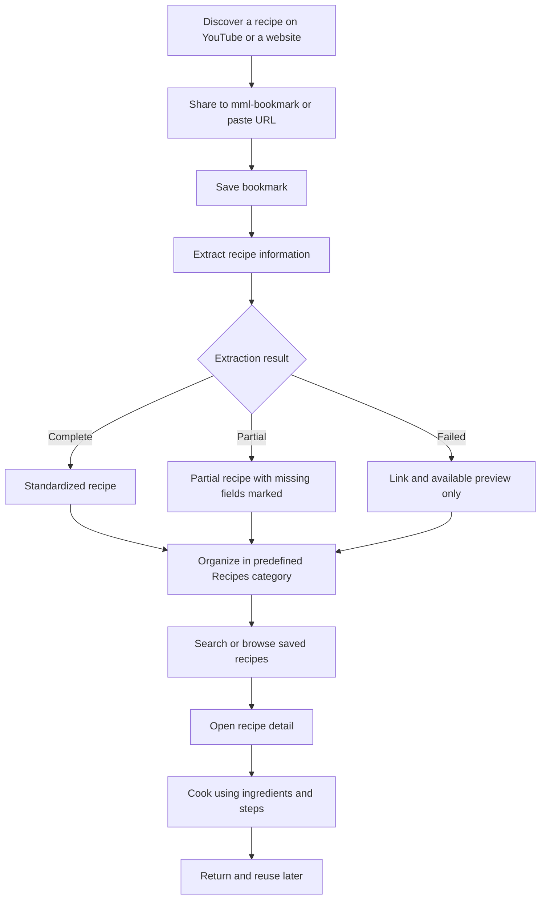

# mml-bookmark — User Journey Map

## Primary persona

Someone who discovers recipes on YouTube Shorts or recipe websites, saves them, and wants to easily find and cook them later.

**Core journey:** Discover → Save → Extract → Organize → Find → Cook → Reuse

## 1. Primary user journey

## 2. Detailed journey map

| Stage | User action | User expectation | mml-bookmark behavior |
|---|---|---|---|
| Discovery | Sees a recipe in a YouTube Short | “I want to try this later.” | User can share or copy its link |
| Capture | Shares link to app | “Save it instantly.” | Creates bookmark with minimal interaction |
| Processing | Waits for recipe extraction | “Get the recipe for me.” | Extracts from description, transcript, available comments, or webpage |
| Organization | Opens saved collection | “Keep everything together.” | Assigns predefined Recipes category |
| Retrieval | Searches for dinner ideas | “Find that pasta recipe.” | Displays saved recipes with images and titles |
| Consumption | Opens a recipe | “Show me what to buy and do.” | Displays standardized ingredients and steps |
| Reuse | Returns another day | “I don't want to find the video again.” | Keeps recipe and source reference accessible |

## 3. Emotional journey (hypothesis)

These values are illustrative design assumptions, not validated user research.

| Stage | Expected sentiment (1–5) | Potential friction |
|---|---:|---|
| Discover | 5 | None within the app |
| Save | 4 | Too many taps or missing share integration |
| Extract | 3 | Waiting, incomplete or inaccurate extraction |
| Organize | 4 | Incorrect categorization |
| Find | 4 | Weak search or unclear titles |
| Cook | 5 | Missing quantities or preparation steps |
| Reuse | 5 | Original content no longer available |

The highest-priority friction points are **capture** and **extraction**. Saving should be effortless; extraction should be transparent about missing information.

## 4. Alternative journeys and edge cases

### A. Incomplete recipe extraction

The system identifies the recipe name and some ingredients but not every quantity or step. It saves a partial recipe, clearly marks missing information, and retains the original source link.

### B. Extraction fails completely

The app saves the original URL and any available preview. It does not require the user to fill out a manual form.

### C. Cross-device use

The user saves a recipe on mobile and opens it later in a browser, or vice versa. The collection remains consistent across devices.

### D. Original content disappears

The app retains previously extracted content where technically and legally supported, along with the original URL, save date, and available thumbnail or transcript. Content that cannot be retained is not promised.

## 5. Suggested MVP screens

| Screen | Purpose | Core elements |
|---|---|---|
| My Collection | Home and navigation | Predefined categories, recent saves, search |
| Save Link | Capture content | URL input, mobile share target, save confirmation |
| Processing State | Communicate extraction progress | Loading state, extraction status, fallback behavior |
| Recipe Detail | Read and cook | Title, image, ingredients, steps, source link, missing-field indicators |
| Search & Browse | Retrieve saved content | Search, recipe cards, categories |

These are proposed screens, not finalized wireframes.

## 6. MVP success metrics

| Metric | What it tells us |
|---|---|
| Save completion rate | Can users reliably capture content? |
| Time to save | Is capture fast enough? |
| Recipe extraction success rate | How often is useful structured content produced? |
| Missing-field frequency | How complete are extracted recipes? |
| Saved-to-opened rate | Do users return to their bookmarks? |
| Recipe reuse rate | Does the app provide ongoing value? |

## 7. Product priority

The defining moment of mml-bookmark is **not saving a URL**. It is opening a saved YouTube recipe and seeing a clean, readable recipe without needing to watch the video again.

For the first release, prioritize this experience over advanced organization, social sharing, or additional content sources.

## 8. Recommended next step

Turn the journey into a screen-by-screen user flow covering onboarding, mobile share sheet, extraction states, error handling, and recipe detail interactions. Use that flow as the foundation for UX wireframes and implementation specifications.
